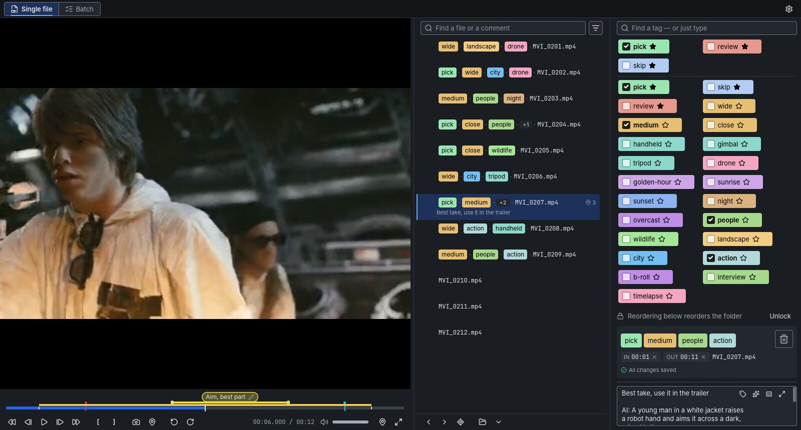
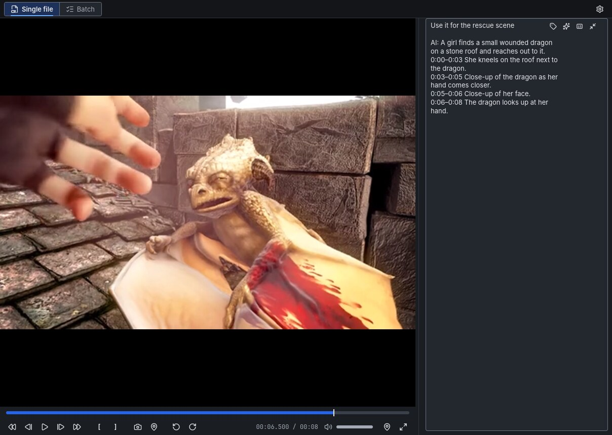
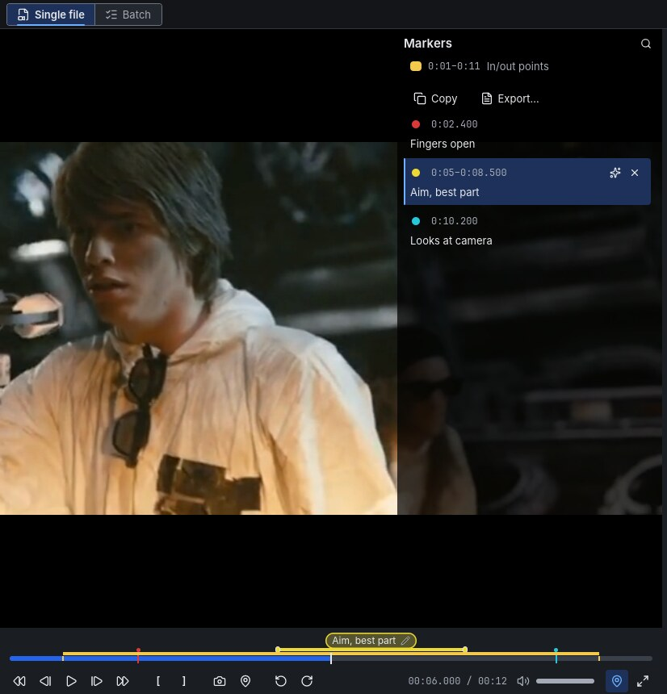
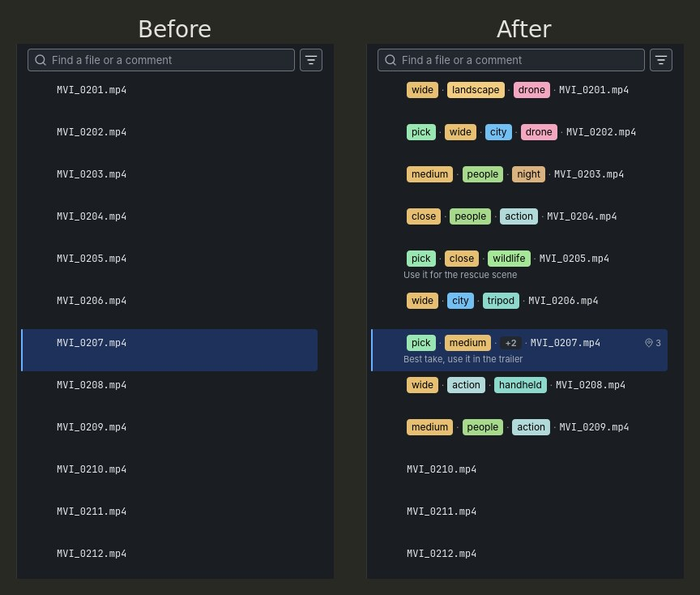
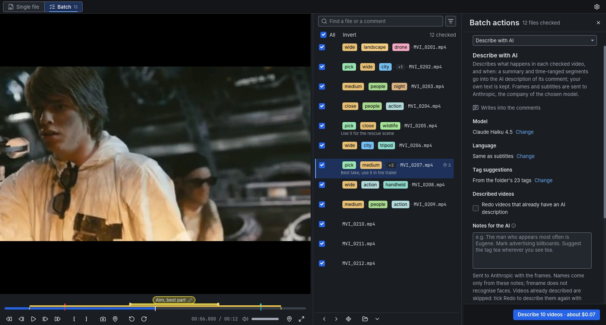

# frename

frename is a free app that gets a folder of raw video ready for the edit. You watch each clip,
tag it, mark the moments you want and let AI describe it, and all of it is in Premiere Pro when
you import the clips.

[Download for Windows](https://github.com/Zelenov/frename/releases/latest/download/frename-win-Setup.exe)
or get the [Linux AppImage and the Windows zip](https://github.com/Zelenov/frename/releases/latest).
A Mac version is not available yet. The app is in English, Russian, German, French, Spanish,
Italian, Brazilian Portuguese, Ukrainian, Serbian, Japanese, Korean and Chinese.

## Describe each clip with AI

frename can write a short description of each clip and list what happens at which second, even
in a clip with no speech. The description goes into the clip's comment, so you can search for it
later, and Premiere Pro shows it in the Description column. AI can also suggest tags, and in and
out points for the part worth keeping.

You use your own key for Claude, ChatGPT or Gemini, and Settings has a button that opens the
page where you get one. With Claude Haiku, 1,000 clips of one minute each cost about $10.

## Mark key moments and the part to keep

Press `F2` to put a marker at a moment you want to find again, and give it a name and a color.
Press `[` and `]` to set the in and out points, so only the good part of the clip goes into
the edit. Premiere Pro shows the markers on the clip, and it uses the in and out points as a
subclip.

## Tag clips so the footage has a structure

Click the tags that fit a clip, or pick them with the keyboard, and frename adds them to the
file name when you move to the next clip. `MVI_0207.mp4` becomes
`pick.medium.people.action.MVI_0207.mp4`, so your file manager, Premiere Pro and your backup
tools all see the tags and can sort by them.

## Work on a whole folder at once

Batch mode runs one action on every clip you check. For example, it makes subtitles from the
speech, describes the clips with AI, suggests tags or turns the clips that were filmed on their
side. A long action runs in the background, and you can keep working while it runs.

## What you get in Premiere Pro

When you import the clips into Premiere Pro, you get the following:

- the tags in each file name, so you can find and sort the clips in the Project panel;
- the markers on each clip, with their names, colors and lengths;
- the in and out points, which Premiere Pro uses as a subclip;
- the comment in the Description column, where search finds it;
- the subtitles as an `.srt` file or as a Premiere Pro transcript, if you made them.

On Windows you can drag clips from frename straight into Premiere Pro.

## Your files and your keys

- frename keeps everything in the clips and next to them, so your work goes with the footage
  when you copy the folder.
- frename sends nothing anywhere unless you ask. When you ask for an AI description or for
  subtitles, the frames or the sound go to the service you chose, with your own key.
- Your keys stay in the password store of your computer.
- `Ctrl+Z` undoes almost everything, and frename keeps your unsaved work safe if the computer
  stops.
- frename is open source under the MIT license.

## More

- [The guide](docs/guide.md) explains every feature, the keyboard shortcuts, the install and
  where frename keeps your data.
- [Building frename from source](docs/development.md) is for developers.
- [What changed in each version](version.md).
